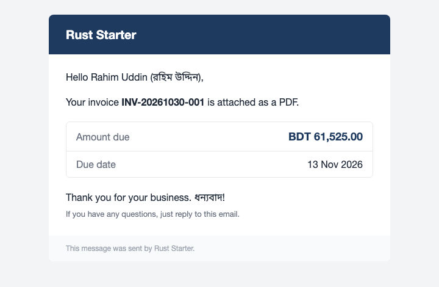
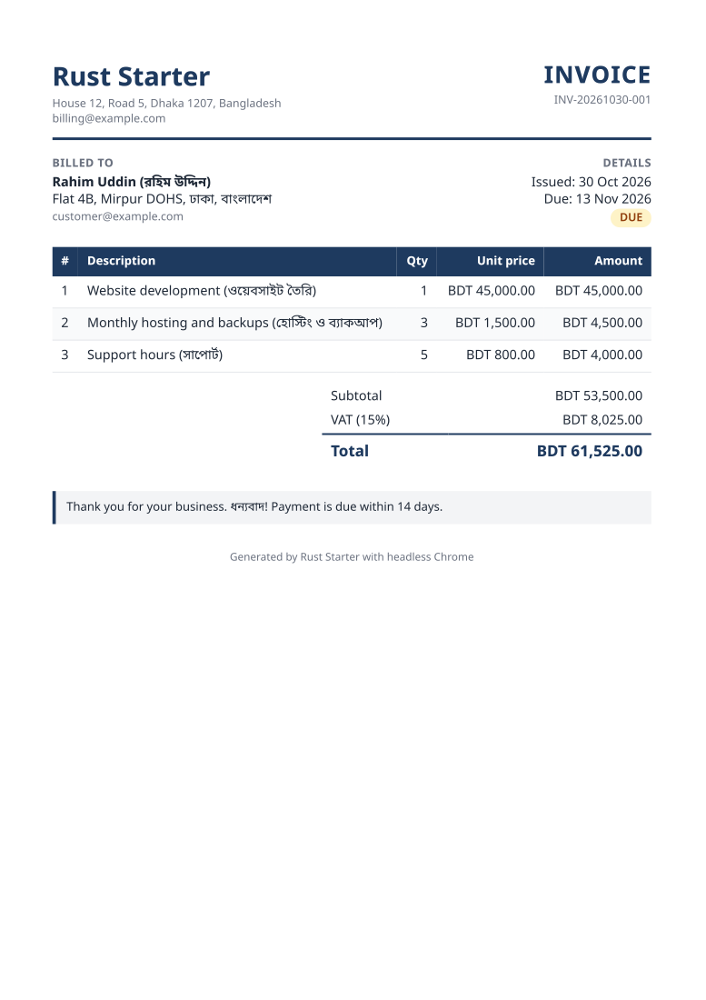

<!-- nav:start -->
**Tutorial 24 of 25** | [Index](00-index.md) | [Previous: 23 PDF and email](23-pdf-and-email.md) | [Next: 25 AI service: Claude, OpenAI and Gemini](25-ai-service.md)

<details><summary>Jump to any tutorial</summary>

[00. Index](00-index.md)  
01. [Introduction](01-introduction.md)  
02. [Setup](02-setup.md)  
03. [Rust essentials](03-rust-essentials.md)  
04. [Project structure](04-project-structure.md)  
05. [Modules and `cargo modular`](05-modules.md)  
06. [Routes, controllers and views](06-routes-controllers-views.md)  
07. [Database: migrations, entities, queries, seeding](07-database.md)  
08. [A bilingual site (English and Bangla)](08-bilingual-site.md)  
09. [Cache and sessions](09-cache-and-sessions.md)  
10. [Testing](10-testing.md)  
11. [Assets and styling](11-assets-and-styling.md)  
12. [Cheat sheet and what to build next](12-cheatsheet.md)  
13. [Console commands and the scheduler](13-console-and-schedule.md)  
14. [Login, register and sessions (`auth` module)](14-auth-and-sessions.md)  
15. [Roles and permissions (`role-permission` module)](15-roles-and-permissions.md)  
16. [The admin dashboard (`admin-layout` module)](16-admin-dashboard.md)  
17. [Media library (`media` module)](17-media-library.md)  
18. [JSON API and Google login](18-json-api-and-google-login.md)  
19. [Components and the contact form](19-components-and-contact-form.md)  
20. [Tinker and sharing the database with Laravel](20-tinker-and-laravel-database.md)  
21. [Conventions](21-conventions.md)  
22. [Activity log, queue monitor and database backups](22-activity-log-queue-and-backups.md)  
23. [PDF and email](23-pdf-and-email.md)  
**24. [Email and PDF step by step](24-email-and-pdf-step-by-step.md)**  
25. [AI service: Claude, OpenAI and Gemini](25-ai-service.md)  

</details>
<!-- nav:end -->

# 24. Email and PDF step by step: the Loco way and our way

This starter can send email in two ways. Pick per job; they can live side by side.

| | **Loco's mailer** (`src/mailers`) | **Our `mail` module** |
|---|---|---|
| Good for | plain, templated emails (welcome, reset) | emails with **attachments** (a PDF), a **log** of every send |
| Attachments | no | yes |
| Generator | `cargo run -- generate mailer <Name>` | `cargo modular make:mail <Name> --module=<module>` |
| Templates | `subject.t`, `text.t`, `html.t` (Tera) | `templates/mails/<name>.html` and `.txt` |
| Settings | `mailer:` in `config/*.yaml` (`MAILER_*`) | `settings.mail` (`MAIL_*`, `AWS_SES_*`) |
| Record | none | `mail_log` table |
| Test | `stub: true`, then `ctx.mailer.unwrap().deliveries()` | `capture` driver, `module_mail::captured()` |

Both can use **Amazon SES**. Set that up once (last part) and come back.

## Part 1: the Loco way

Loco ships a mailer. The auth emails here use it: `src/mailers/auth.rs`.

**1. Generate it.**

```sh
cargo run -- generate mailer InvoiceNotice
```

It adds a mailer under `src/mailers/` and a template folder. Open `src/mailers/auth.rs` to see the pattern.

**2. Write the templates.** One folder per email, three Tera files (`src/mailers/auth/welcome/`):

```text
subject.t    Welcome {{name}}
text.t       Dear {{name}}, welcome ...
html.t       <p>Dear {{name}}, welcome ...</p>
```

**3. Send it.**

```rust
static welcome: Dir<'_> = include_dir!("src/mailers/auth/welcome");

impl Mailer for AuthMailer {}
impl AuthMailer {
    pub async fn send_welcome(ctx: &AppContext, user: &users::Model) -> Result<()> {
        Self::mail_template(ctx, &welcome, mailer::Args {
            to: user.email.clone(),
            locals: json!({ "name": user.name }),   // the {{name}} in the templates
            ..Default::default()                    // set `from` to your verified sender
        }).await?;
        Ok(())
    }
}
```

**4. Configure where it goes.** In development it defaults to a local catcher on port 1025:

```sh
docker run -p 1025:1025 -p 8025:8025 axllent/mailpit      # read the mail at http://localhost:8025
```

**5. Send through SES instead.** Set in `.env` (the `mailer:` block in `config/*.yaml` reads these):

```sh
MAILER_HOST=email-smtp.ap-southeast-1.amazonaws.com
MAILER_PORT=587
MAILER_SECURE=true          # STARTTLS
MAILER_USER=...             # from the next command
MAILER_PASSWORD=...
```

SES does not accept your IAM secret key as the SMTP password; it needs one derived from it. This prints the user and the password (keep them in `.env`), then uncomment the `auth:` lines of the `mailer:` block:

```sh
cargo run -- task mail:ses-smtp-password
```

**6. Test it.** `config/test.yaml` has `stub: true`, so nothing is sent and you can count:

```rust
let deliveries = ctx.mailer.unwrap().deliveries();
assert_eq!(deliveries.count, 1);
```

Loco's mailer cannot attach files and keeps no record. When you need either, use Part 2.

## Part 2: our way, with a PDF attached

We will email an invoice with a PDF. The result:

| The email | The attached PDF |
|---|---|
|  |  |

**1. A module and a mail class.**

```sh
cargo modular make:module billing
cargo modular make:mail InvoiceReady --module=billing
```

The second command creates `src/mails/invoice_ready.rs`, `templates/mails/invoice_ready.html` and `.txt`, registers them, and adds the `module-mail` dependency. Also add `module-pdf = { path = "../pdf" }` to `modules/billing/Cargo.toml`.

**2. Fill in the class and the templates.** The class builds a `Mail` from your data:

```rust
pub struct InvoiceReady { pub to: String, pub name: String }

impl InvoiceReady {
    pub fn build(&self) -> Result<Mail> {
        let data = json!({ "name": self.name });
        Mail::to(&self.to)
            .subject("Your invoice")
            .html_template(include_str!("../../templates/mails/invoice_ready.html"), &data)?
            .text_template(include_str!("../../templates/mails/invoice_ready.txt"), &data)
    }
}
```

The templates are Tera: `<p>Hello {{ name }}</p>`. Values are HTML-escaped. Email clients ignore most CSS, so write the HTML with tables and inline `style=""` (see `modules/mail/templates/invoice.html`).

**3. Make the PDF.** `module_pdf::Invoice` is a ready-made sample; for your own, copy `modules/pdf/templates/pdf/invoice.html` and render it:

```rust
let pdf = module_pdf::Invoice::sample("customer@example.com")
    .pdf(&module_pdf::PdfOptions::from_env())     // headless Chrome prints the HTML to a PDF
    .await?;
```

It needs Chrome or Chromium installed (`CHROME_PATH` if it is not found) and, for Bangla, a Bangla font.

**4. Attach and send.**

```rust
pub async fn email_invoice(ctx: &AppContext, invoice: &Invoice) -> Result<()> {
    let pdf = invoice.pdf(&PdfOptions::from_env()).await?;
    let mail = InvoiceReady { to: invoice.customer.email.clone(), name: invoice.customer.name.clone() }
        .build()?
        .attach_pdf(&format!("{}.pdf", invoice.number), pdf);
    module_mail::send(ctx, mail).await?;           // recorded in mail_log
    Ok(())
}
```

**5. Try it safely first.** With the default `MAIL_DRIVER=log` nothing is sent; the whole email, attachment included, is written to `storage/mail/*.eml`, which you can open in any mail program:

```sh
cargo run -- task mail:send-invoice to:you@example.com
```

**6. Send it for real.**

```sh
MAIL_DRIVER=ses cargo run -- task mail:send-invoice to:you@example.com
# sent via ses to you@example.com (log #2), provider answer: Ok 010e01a1...-000000
```

The answer is SES's message id. Look at the record with `select status, provider_id, error from mail_log order by id desc limit 5;`. To make SES the default, set `MAIL_DRIVER=ses` in `.env`.

**7. Test it without sending anything.**

```rust
let config = MailConfig::from_value(json!({ "driver": "capture", "from_address": "support@example.com" }))?;
send_with(&ctx.db, &config, mail).await?;
assert_eq!(module_mail::captured().len(), 1);     // the raw message is there, PDF and all
```

## Part 3: set up Amazon SES once

1. **Pick a region** (for example `ap-southeast-1`) and use it everywhere: the SES console, `AWS_SES_DEFAULT_REGION`, `MAILER_HOST`.
2. **Verify the sender** under *Verified identities*: a single address, or better a whole domain with its DKIM records (it improves delivery and keeps mail out of spam). `MAIL_FROM_ADDRESS` must belong to a verified identity.
3. **Sandbox:** a new account can only send to verified addresses. Verify your test recipient, or ask AWS for *production access*.
4. **An IAM user** whose policy allows sending:

   ```json
   { "Version": "2012-10-17",
     "Statement": [{ "Effect": "Allow", "Action": ["ses:SendRawEmail"], "Resource": "*" }] }
   ```

   Create an access key for it.
5. **`.env`** (never commit it):

   ```sh
   MAIL_FROM_ADDRESS=support@example.com
   MAIL_FROM_NAME=My App
   AWS_SES_ACCESS_KEY_ID=...
   AWS_SES_SECRET_ACCESS_KEY=...
   AWS_SES_DEFAULT_REGION=ap-southeast-1
   ```

## When something goes wrong

| What you see | Usually means |
|---|---|
| `554 Message rejected: Email address is not verified` | the sender (or, in the sandbox, the recipient) is not verified in this region |
| `535 Authentication Credentials Invalid` | wrong key, or the region differs from the one used for the password |
| `AccessDenied ... ses:SendRawEmail` | the IAM user's policy does not allow it |
| it hangs, then times out | your network blocks outgoing port 587 |
| `could not find Chrome or Chromium` | install it, or set `CHROME_PATH` |
| Bangla shows empty boxes in the PDF | no Bangla font on the machine; install one (for example Noto Sans Bengali) |
| mail lands in spam | verify the domain with DKIM, and send from that domain |

A failed send is always in `mail_log` with its error text.

## Which one to use

Use **Loco's mailer** for simple templated messages that the framework's own flows send. Use the **`mail` module** whenever you need an attachment, a record of what was sent, or a PDF. They do not conflict: each reads its own settings.

<!-- foot:start -->
---
[Previous: 23 PDF and email](23-pdf-and-email.md) | [Index](00-index.md) | [Next: 25 AI service: Claude, OpenAI and Gemini](25-ai-service.md)
<!-- foot:end -->
